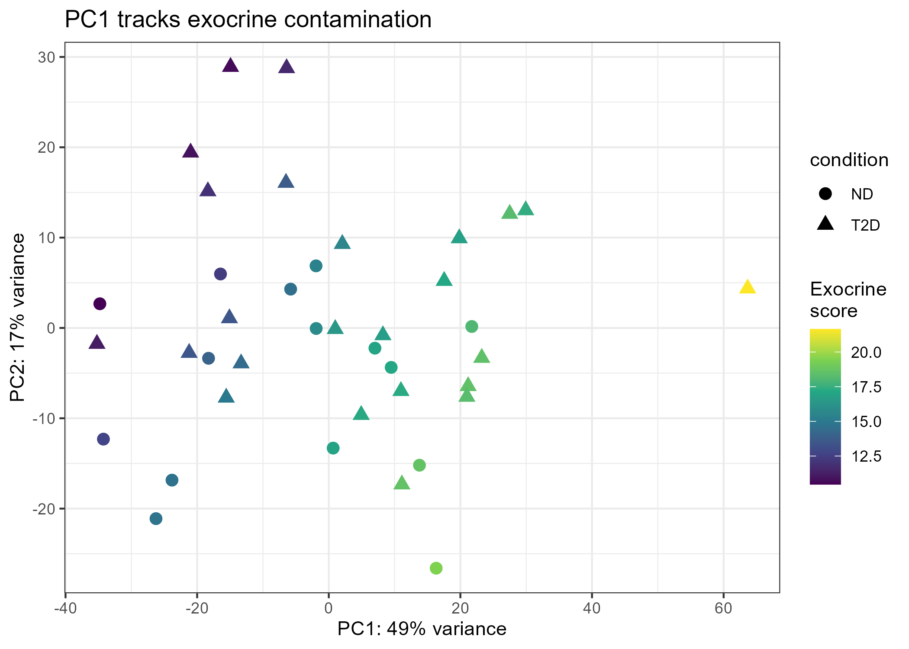
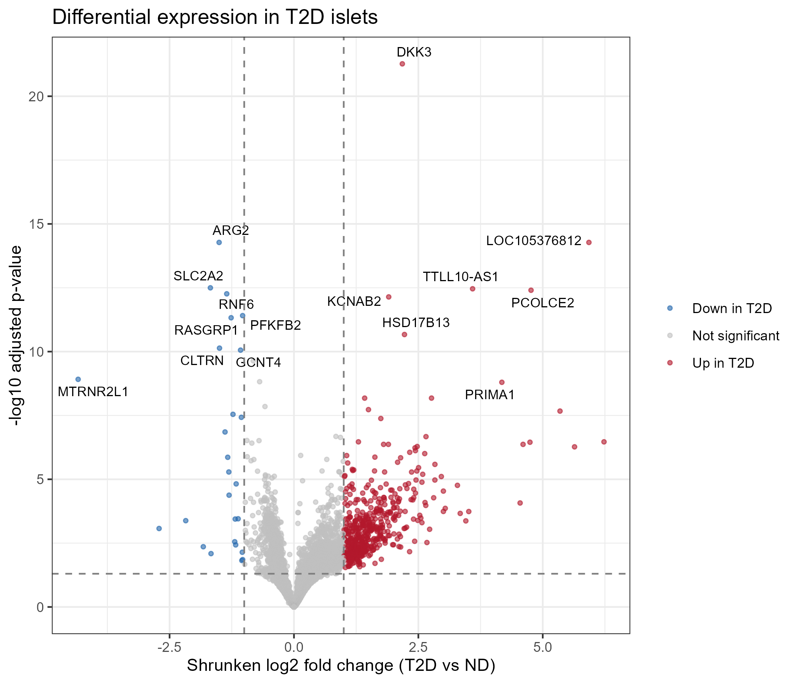
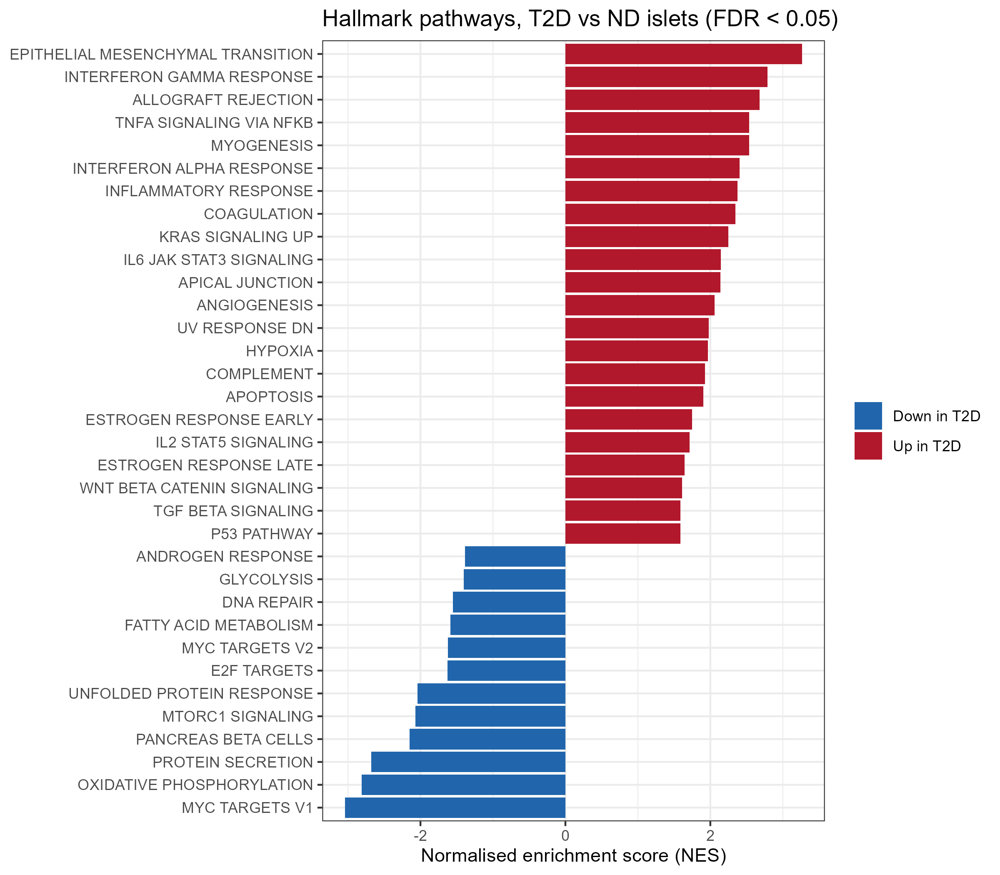
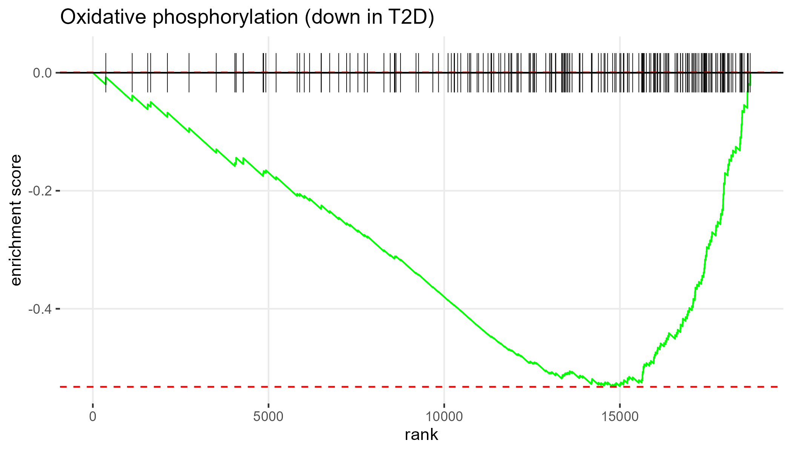

# Transcriptomic changes in pancreatic islets in type 2 diabetes

Differential expression and pathway analysis of human pancreatic islets from donors with type 2 diabetes (T2D) and non-diabetic (ND) donors, using public RNA-seq data (GEO: [GSE164416](https://www.ncbi.nlm.nih.gov/geo/query/acc.cgi?acc=GSE164416)) and DESeq2 in R.

## Question

Which genes and pathways differ between T2D and ND islets once library batch and exocrine contamination are accounted for?

## Data

- **Source:** GSE164416 (Wigger et al., *Nature Metabolism* 2021, [doi:10.1038/s42255-021-00420-9](https://doi.org/10.1038/s42255-021-00420-9)). Islets were isolated by laser capture microdissection from pancreatic tissue of 133 metabolically phenotyped patients undergoing partial pancreatectomy.
- **Input:** NCBI-generated raw counts (GRCh38.p13) and NCBI gene annotation, with sample metadata from GEO via GEOquery.
- **Analysis set:** ND (n = 15) vs T2D (n = 24). Only samples flagged by the submitters as passing their insulin-based purity filter (`in_ins_filtered_data_subset`) were used. Flagged samples had about twice the INS expression of unflagged ones (median 53,500 vs 27,300 counts per million).

## Workflow

| Script | Step |
|---|---|
| `01_load_data.R` | Download counts and annotation, load GEO metadata, define the analysis set |
| `02_qc.R` | Low-count filter, VST, PCA, exocrine contamination score, final design |
| `03_deseq2.R` | DESeq2 fit, apeglm shrinkage, gene annotation, volcano plot |
| `04_gsea.R` | Pre-ranked GSEA with fgsea and MSigDB Hallmark gene sets |
| `05_sensitivity.R` | Re-analysis with all samples and without the outlier sample |

Open `GSE164416-islets-t2d.Rproj` and run the scripts in order. Package versions are listed in `results/sessionInfo.txt`.

## Quality control

Genes with at least 10 counts in at least 15 samples were kept (18,716 genes). In a PCA of variance-stabilised data, PC1 (49% of variance) did not separate ND from T2D. Instead, it correlated strongly with acinar marker genes (PRSS1 r = 0.87, CPA1 r = 0.89, CELA3A r = 0.87). This points to variable exocrine contamination of the microdissected islets as the largest source of variation.



Contamination did not differ between groups (Wilcoxon p = 0.83). Because it explains so much variance, a per-sample exocrine score was added as a covariate. The score is the mean VST of six acinar genes (PRSS1, CPA1, CELA3A, CTRB1, CPB1, PNLIP), scaled. Library preparation date (five batches) was also included.

**Final design:** `~ batch + exocrine + condition`

## Differential expression

- 3,085 genes at FDR < 0.05: 1,863 higher and 1,222 lower in T2D.
- 536 genes at FDR < 0.05 with |shrunken log2 fold change| > 1: 510 higher and 26 lower.
- Genes with large increases were mostly low-expressed in islets (median mean count 47, vs 167 for non-significant genes). This fits signals from minor cell populations, or from genes that are normally kept silent in islet cells.

Ten most significant genes with mean normalised count > 50:

| Gene | Mean count | Shrunken log2FC | FDR |
|---|---|---|---|
| DKK3 | 318 | 2.18 | 5.4e-22 |
| ARG2 | 718 | -1.50 | 5.3e-15 |
| SLC2A2 | 487 | -1.68 | 3.2e-13 |
| RNF6 | 2,086 | -1.35 | 5.5e-13 |
| KCNAB2 | 93 | 1.90 | 7.2e-13 |
| PFKFB2 | 12,863 | -1.03 | 3.9e-12 |
| RASGRP1 | 606 | -1.26 | 4.7e-12 |
| HSD17B13 | 533 | 2.22 | 2.1e-11 |
| CLTRN | 555 | -1.50 | 7.3e-11 |
| GCNT4 | 1,177 | -1.07 | 8.7e-11 |

SLC2A2 (GLUT2), the main glucose transporter of human beta cells, was among the strongest decreases. ALDOB was increased (log2FC 2.76, FDR 6.6e-09). Full results are in `results/deseq2_T2D_vs_ND.csv`.



## Pathway analysis

Genes were ranked by the DESeq2 Wald statistic and tested against the 50 MSigDB Hallmark gene sets. 34 sets were enriched at FDR < 0.05.

- **Lower in T2D:** MYC targets V1 (NES -3.04), oxidative phosphorylation (-2.81), protein secretion (-2.68), mTORC1 signalling, unfolded protein response, and the pancreas beta-cell gene set.
- **Higher in T2D:** epithelial-mesenchymal transition (3.27), interferon-gamma response (2.79), TNF-alpha signalling via NF-kB (2.54), inflammatory response, complement, IL6/JAK/STAT3 and TGF-beta signalling.

Together these show lower mitochondrial, biosynthetic and secretory gene programmes in T2D islets, alongside inflammatory and extracellular-matrix signatures. In bulk tissue the EMT gene set is driven mainly by collagen and matrix genes. It is better read as fibrosis or stromal expansion than as a change in beta-cell identity.





## Sensitivity analysis

The full pipeline was re-run on two alternative sample sets and compared with the main analysis (genes at FDR < 0.05 in the main analysis):

| Analysis | log2FC correlation | Still FDR < 0.05 | Same direction |
|---|---|---|---|
| All ND and T2D samples, no purity filter (n = 57) | 0.944 | 2,379 / 3,085 | 99.9% |
| Without the most contaminated sample (n = 38) | 0.996 | 2,992 / 3,074 | 100% |

Neither the purity filter nor the outlier sample drives the conclusions.

## Limitations

- All donors underwent pancreatic surgery for pancreatic disease. ND donors are non-diabetic patients, not healthy controls, and part of the inflammatory signal may come from the surrounding diseased tissue.
- These are bulk transcriptomes, so changes in cell-type proportions (for example fewer beta cells) cannot be separated from changes in expression per cell. Lower beta-cell genes such as SLC2A2 may partly reflect beta-cell loss.
- Age, sex and BMI are not in the GEO metadata and were not adjusted for.
- The insulin-based purity filter excluded proportionally more T2D samples (15 of 39) than ND samples (3 of 18). This may bias against T2D donors with the lowest insulin expression.
- Single cohort with no external validation.

## Possible extensions

- Cell-type deconvolution using a single-cell islet reference.
- Adding donors with impaired glucose tolerance to test for graded changes from ND to IGT to T2D.
- Replication in an independent islet cohort.

## Repository structure

```
├── 01_load_data.R ... 05_sensitivity.R
├── figures/      PNG figures
├── results/      CSV result tables and sessionInfo.txt
└── data/         raw inputs, downloaded by 01_load_data.R (not tracked)
```

## Author

**Abdulmohsen Almutairi**
MSc Biochemistry at University of Jeddah
abdulmohsen.khalef@gmail.com

## License

MIT
